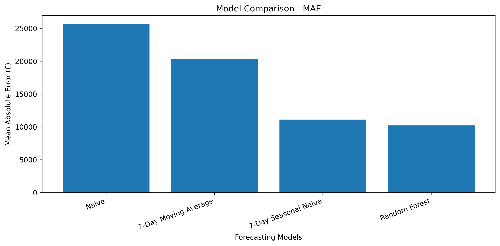
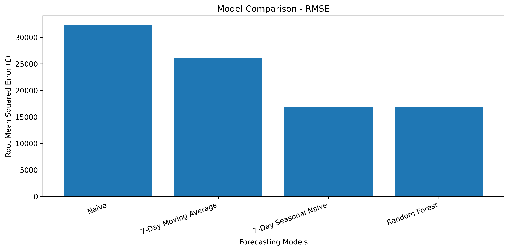
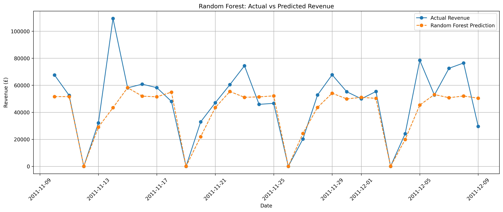
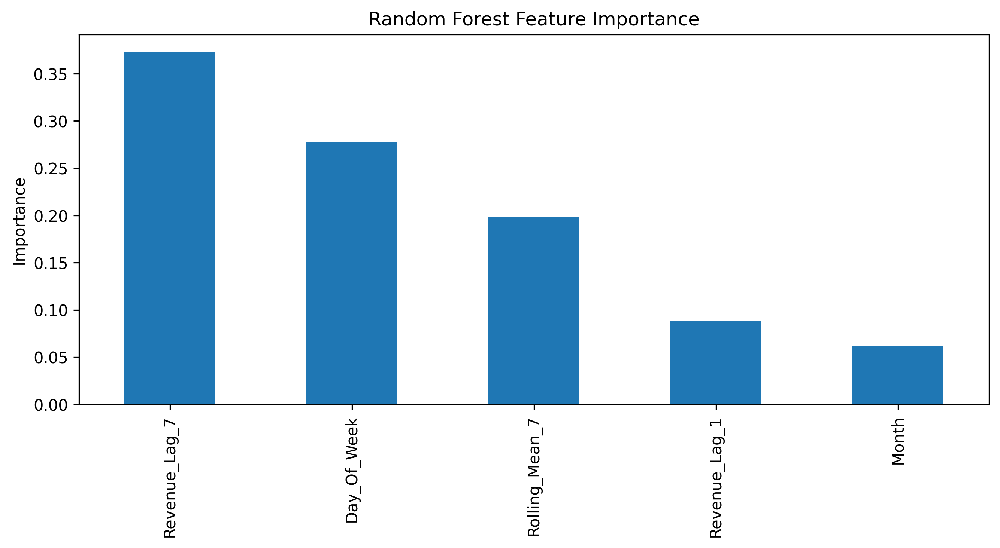

# Retail Sales Forecasting Using Machine Learning

## Project Overview

This project focuses on analysing online retail sales data to identify sales trends, understand customer purchasing patterns, and forecast daily revenue using machine learning techniques.

The project uses historical retail transaction data to perform data cleaning, exploratory data analysis, feature engineering, and forecasting model evaluation. Different forecasting models are compared to identify the model that provides the most accurate revenue predictions.

## Dataset Information

- **Dataset:** Online Retail Dataset
- **Source:** UCI Machine Learning Repository
- **Original Records:** 541,909
- **Number of Columns:** 8
- **Data Period:** December 2010 – December 2011
- **Data Type:** Online retail transaction data

The dataset contains information about invoices, products, quantities, transaction dates, prices, and customers.

## Tools and Technologies Used

- **Programming Language:** Python
- **Environment:** Jupyter Notebook
- **Libraries:** Pandas, NumPy, Matplotlib, Scikit-learn
- **Techniques:** Data Cleaning, Exploratory Data Analysis, Feature Engineering, Time Series Forecasting, Machine Learning

## Data Cleaning and Preprocessing

The original dataset was inspected and cleaned before performing the analysis.

The following steps were carried out:

- Removed duplicate records.
- Removed transactions with zero or negative unit prices.
- Calculated revenue using Quantity × UnitPrice.
- Excluded non-product transactions such as postage and manual adjustments.
- Retained negative quantities to account for returns and cancellations.
- Aggregated transaction data into daily and monthly sales records.

After cleaning, the dataset contained **531,574 records** for product sales analysis.

## Exploratory Data Analysis (EDA)

Exploratory Data Analysis was performed to identify patterns and trends in retail sales.

The analysis included:

- Daily and monthly revenue analysis.
- Identification of the highest-revenue month.
- Analysis of top-performing products.
- Comparison of Christmas-related product revenue.
- Examination of transaction counts and sales quantities.

## Forecasting Models

Four forecasting models were implemented and evaluated to predict daily retail revenue.

### Models Used

1. **Naive Forecasting:** Uses the previous day's revenue as the prediction for the current day.

2. **7-Day Moving Average:** Calculates the average revenue of the previous seven days to predict the next day's revenue.

3. **7-Day Seasonal Naive:** Uses the revenue from the same weekday in the previous week as the prediction.

4. **Random Forest Regressor:** A machine learning model that uses historical revenue, lag features, rolling averages, weekday, and month information to predict daily revenue.

### Feature Engineering

The following features were created to improve the forecasting model:

- **Revenue Lag 1:** Revenue from the previous day.
- **Revenue Lag 7:** Revenue from seven days earlier.
- **Rolling Mean 7:** Average revenue over the previous seven days.
- **Day of Week:** Represents the day of the week.
- **Month:** Represents the month of the transaction.

### Model Evaluation

The dataset was divided into training and testing periods based on chronological order to avoid using future data to predict the past.

- **Training Data:** First 344 days of the dataset.
- **Testing Data:** Last 30 days of the dataset.
- **Testing Period:** November 10, 2011 – December 9, 2011.

The models were evaluated using the following performance metrics:

- **MAE (Mean Absolute Error):** Measures the average absolute difference between actual and predicted revenue. Lower MAE indicates better prediction accuracy.
- **RMSE (Root Mean Squared Error):** Measures the square root of the average squared prediction errors. It gives greater weight to larger errors. Lower RMSE indicates better performance.

### Model Performance Comparison

| Model | MAE (£) | RMSE (£) |
|---|---:|---:|
| Naive | 25,658.13 | 32,419.12 |
| 7-Day Moving Average | 20,345.52 | 26,086.03 |
| 7-Day Seasonal Naive | 11,109.39 | 16,885.36 |
| Random Forest | **10,200.21** | **16,859.27** |

The Random Forest Regressor achieved the lowest MAE and RMSE among the four models, making it the best-performing model in this evaluation.

## Key Findings

- November 2011 recorded the highest monthly revenue in the available dataset.
- Christmas-related product revenue increased from September to November.
- The 7-Day Seasonal Naive model performed significantly better than the basic Naive and Moving Average models.
- The Random Forest model achieved the lowest forecasting error among the four models.
- Revenue from the previous seven days and the day of the week were the most important features in the Random Forest model.
- The model was able to capture general revenue patterns but struggled to predict sudden sales spikes and extreme fluctuations.

## Project Limitations

- The dataset covers approximately one year of transactions, which limits the ability to identify recurring yearly sales patterns.
- The Random Forest model struggled to predict sudden increases and decreases in daily revenue.
- The forecasting models were evaluated using a 30-day testing period, so the results may differ on other periods.
- The analysis is based on historical sales data and does not account for external factors such as promotions, market changes, or economic conditions.

## Future Improvements

- Explore additional time series forecasting techniques.
- Include external factors such as holidays, promotions, and seasonal events.
- Experiment with additional features to improve prediction accuracy.
- Evaluate the models using different testing periods.

## Project Visualizations

### 1. Model Comparison - MAE

### 2. Model Comparison - RMSE

### 3. Actual vs Predicted Revenue

### 4. Random Forest Feature Importance

### Dataset Attribution

This project uses the publicly available **Online Retail dataset** from the UCI Machine Learning Repository.

**Original Source:** https://archive.ics.uci.edu/dataset/352/online+retail

**Citation:** Chen, D. (2015). *Online Retail* [Dataset]. UCI Machine Learning Repository. https://doi.org/10.24432/C5BW33

**License:** Creative Commons Attribution 4.0 International (CC BY 4.0).

The dataset was used for educational and portfolio purposes. Data cleaning, exploratory analysis, feature engineering, and forecasting models were independently implemented as part of this project.
